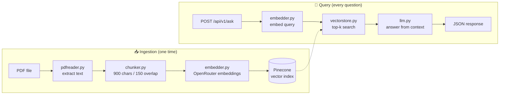

<div align="center">

# 📄 HR Policy RAG Assistant

**A REST API that answers questions about a PDF, grounded in the document's own content.**


</div>

---

## 📚 Table of Contents

- [Overview](#-overview)
- [Features](#-features)
- [How It Works](#-how-it-works)
- [Project Structure](#-project-structure)
- [Getting Started](#-getting-started)
- [Running the API](#-running-the-api)
- [API Reference](#-api-reference)
- [Configuration](#-configuration)
- [Module Reference](#-module-reference)
- [Troubleshooting](#-troubleshooting)
- [Roadmap](#-roadmap)
- [License](#-license)

---

## 🔍 Overview

This project is a small, readable **Retrieval-Augmented Generation (RAG)** pipeline.
It reads a PDF (an HR policy by default), splits it into overlapping chunks, turns each chunk into an embedding, and stores them in **Pinecone**.

The whole pipeline is served as a **FastAPI** REST API. When you send a question to `POST /api/v1/ask`, the API embeds your question, retrieves the most relevant chunks from Pinecone, and sends them to an LLM through **OpenRouter**. The LLM answers **only from the retrieved context**. If the document doesn't contain the answer, it says so instead of guessing.

> **Example:** *"If my performance is bad, how many days is the probation period?"*
> The assistant finds the probation section of the HR policy and answers from it.

---

## ✨ Features

- 🗂️ **PDF ingestion:** extracts text from every page with `pypdf`.
- ✂️ **Overlapping chunking:** 900-character chunks with 150 characters of overlap keep context intact across boundaries.
- 🧠 **Free embeddings and LLM:** uses free models on OpenRouter.
- ⚡ **Fast semantic search:** Pinecone returns the top-k most similar chunks.
- 🛡️ **Grounded answers:** the system prompt stops the model from answering beyond the context.
- 🌐 **REST API with FastAPI:** typed request and response models, validation, and clear error codes.
- 📖 **Interactive docs:** Swagger UI at `/docs` and ReDoc at `/redoc`, generated automatically.
- ♻️ **Smart ingestion:** ingests the PDF on startup only when the index is empty; re-ingest any time with `POST /api/v1/ingest`.

---

## ⚙️ How It Works



| Step | What happens | Module |
|------|--------------|--------|
| 1. Read | Extract text from each PDF page | `pdfreader.py` |
| 2. Chunk | Join the pages and split into overlapping windows | `chunker.py` |
| 3. Embed | Convert each chunk into a vector | `embedder.py` |
| 4. Store | Upsert vectors and the chunk text into Pinecone in batches of 100 | `vectorstore.py` |
| 5. Retrieve | Embed the question and fetch the top 4 matching chunks | `embedder.py`, `vectorstore.py` |
| 6. Generate | Send the question and context to the LLM | `llm.py` |

---

## 🗂️ Project Structure

```text
.
├── main.py              # FastAPI app: routes, request/response models, startup ingestion
├── pdfreader.py         # Reads the PDF and returns a list of page texts
├── chunker.py           # Splits text into overlapping chunks
├── embedder.py          # Embeds chunks and queries through OpenRouter
├── vectorstore.py       # Pinecone client: store and search vectors
├── llm.py               # Builds the prompt and calls the LLM through OpenRouter
├── resources/
│   └── HR_Policy_RAG_Demo.pdf   # Source document
├── requirements.txt     # Python dependencies
├── .env.example         # Template for the required environment variables
└── README.md
```

---

## 🚀 Getting Started

### Prerequisites

- Python **3.9+**
- An [OpenRouter](https://openrouter.ai/) API key (free tier works)
- A [Pinecone](https://www.pinecone.io/) account and index

### 1. Clone the repository

```bash
git clone https://github.com/<your-username>/<your-repo>.git
cd <your-repo>
```

### 2. Create a virtual environment

```bash
python -m venv venv

# macOS / Linux
source venv/bin/activate

# Windows
venv\Scripts\activate
```

### 3. Install dependencies

```bash
pip install -r requirements.txt
```

`requirements.txt`:

```text
fastapi
uvicorn[standard]
openai
pinecone
pypdf
python-dotenv
```

### 4. Configure environment variables

Copy `.env.example` to `.env` and fill in your keys:

```env
OPENROUTER_API_KEY=your_openrouter_api_key
PINECONE_API_KEY=your_pinecone_api_key
PINECONE_INDEX_NAME=your_index_name
```

> ⚠️ Never commit your `.env` file. Add it to `.gitignore`.

### 5. Create the Pinecone index

Create an index in the Pinecone console with:

- **Metric:** `cosine`
- **Dimension:** the output size of your embedding model (check the model page on OpenRouter). It must match exactly, or the upserts will fail.

---

## ▶️ Running the API

Put your PDF at `resources/HR_Policy_RAG_Demo.pdf`, or change `PDF_PATH` in `main.py`. Then start the server:

```bash
uvicorn main:app --reload
```

You can also run `python main.py`. The API is served at **http://127.0.0.1:8000**.

On startup, if the Pinecone index is empty, the default PDF is ingested automatically. After that, startup is instant.

| URL | Description |
|-----|-------------|
| http://127.0.0.1:8000/docs | Swagger UI, where you can try every endpoint in the browser |
| http://127.0.0.1:8000/redoc | ReDoc API documentation |

---

## 📡 API Reference

| Method | Endpoint | Description |
|--------|----------|-------------|
| `GET` | `/health` | Service health and number of stored vectors |
| `POST` | `/api/v1/ask` | Ask a question and get an answer |
| `POST` | `/api/v1/ingest` | Ingest (or re-ingest) a PDF into Pinecone |

### `POST /api/v1/ask`

Ask a question about the document.

**Request body**

| Field | Type | Required | Default | Description |
|-------|------|----------|---------|-------------|
| `question` | string | ✅ | | The question to ask |
| `top_k` | integer (1–20) | | `4` | Number of chunks to retrieve |
| `include_sources` | boolean | | `false` | Also return the retrieved chunks |

```json
{
  "question": "If my performance is bad, how many days is the probation period?",
  "top_k": 4,
  "include_sources": true
}
```

**Response** `200 OK`

```json
{
  "question": "If my performance is bad, how many days is the probation period?",
  "answer": "According to the policy, the probation period can be extended ...",
  "sources": [
    "Probation Period: All new employees ...",
    "..."
  ]
}
```

`sources` is `null` unless `include_sources` is `true`.

**cURL**

```bash
curl -X POST http://127.0.0.1:8000/api/v1/ask \
  -H "Content-Type: application/json" \
  -d '{"question": "How many casual leaves do I get per year?"}'
```

**Python**

```python
import requests

res = requests.post(
    "http://127.0.0.1:8000/api/v1/ask",
    json={"question": "How many casual leaves do I get per year?"},
)
print(res.json()["answer"])
```

### `POST /api/v1/ingest`

Reads a PDF, chunks it, embeds it and stores it in Pinecone. Every field is optional, so an empty body ingests the default PDF.

**Request body**

| Field | Type | Default | Description |
|-------|------|---------|-------------|
| `pdf_path` | string | `./resources/HR_Policy_RAG_Demo.pdf` | Path to the PDF on the server |
| `chunk_size` | integer | `900` | Characters per chunk |
| `chunk_overlap` | integer | `150` | Overlap between chunks; must be smaller than `chunk_size` |

```json
{
  "pdf_path": "./resources/HR_Policy_RAG_Demo.pdf",
  "chunk_size": 900,
  "chunk_overlap": 150
}
```

**Response** `200 OK`

```json
{
  "message": "Ingestion complete",
  "pdf_path": "./resources/HR_Policy_RAG_Demo.pdf",
  "chunks_stored": 42
}
```

### `GET /health`

**Response** `200 OK`

```json
{
  "status": "ok",
  "vector_count": 42
}
```

### Error responses

Errors follow FastAPI's standard shape:

```json
{ "detail": "Failed to generate answer: ..." }
```

| Status | When |
|--------|------|
| `404` | The PDF file for ingestion was not found |
| `422` | Invalid request body, such as an empty `question` or `chunk_overlap >= chunk_size` |
| `502` | An upstream call to OpenRouter or Pinecone failed |
| `503` | Pinecone is unreachable (from `/health`) |

> 🔒 `/api/v1/ingest` reads files from the server's disk and has no authentication. Keep it private, or protect it before you deploy the API publicly.

---

## 🔧 Configuration

| Setting | Location | Default | Description |
|---------|----------|---------|-------------|
| `PDF_PATH` | `main.py` | `./resources/HR_Policy_RAG_Demo.pdf` | Document to ingest |
| `chunk_size` | `/api/v1/ingest` body | `900` | Characters per chunk |
| `chunk_overlap` | `/api/v1/ingest` body | `150` | Characters shared between neighbouring chunks |
| `top_k` | `/api/v1/ask` body | `4` | Number of chunks sent to the LLM |
| `NAMESPACE` | `main.py` | `""` | Pinecone namespace |
| `EMBEDDING_MODEL` | `embedder.py` | `liquid/lfm-2.5-embedding-350m:free` | Embedding model on OpenRouter |
| `LLM_MODEL` | `llm.py` | `openrouter/free` | Chat model; `openrouter/free` picks an available free model |
| `temperature` | `llm.py` | `0.4` | Lower values give more focused answers |

---

## 🧩 Module Reference

<details>
<summary><b>pdfreader.py</b>: <code>read_pdf(pdf_path) -> List[str]</code></summary>

Checks that the file exists and returns one string per page. Pages with no extractable text, such as scanned images, become empty strings.
</details>

<details>
<summary><b>chunker.py</b>: <code>chunk_pages(pages, chunk_size=900, chunk_overlap=150) -> List[str]</code></summary>

Joins all pages into one string and slides a window of `chunk_size` characters, stepping forward by `chunk_size - chunk_overlap`. Empty chunks are skipped.
</details>

<details>
<summary><b>embedder.py</b>: <code>embed_chunks(chunks)</code> / <code>embed_User_query(query)</code></summary>

Calls the OpenRouter embeddings endpoint through the OpenAI SDK and returns the vectors.
</details>

<details>
<summary><b>vectorstore.py</b>: <code>store_in_pinecone(...)</code> / <code>search_in_pinecone(...)</code></summary>

Upserts vectors with IDs `chunk_0`, `chunk_1` and so on, and keeps the original text in the metadata. Search returns the `text` metadata of the top-k matches.
</details>

<details>
<summary><b>llm.py</b>: <code>query_llm_with_context(query, context) -> str</code></summary>

Joins the retrieved chunks into one context block and asks the LLM to answer strictly from it.
</details>

---

## 🛠️ Troubleshooting

| Problem | Likely cause and fix |
|---------|----------------------|
| `FileNotFoundError` | The PDF isn't at `PDF_PATH`. Check the path and the file name. |
| Pinecone dimension mismatch | The index dimension doesn't match the embedding model. Recreate the index with the right dimension. |
| `401` / authentication error | A key in `.env` is missing or wrong. |
| `429` / rate limit | Free models are rate limited. Wait a moment and try again. |
| "Cannot answer based on the given context" | The PDF doesn't cover the question, or a larger `top_k` is needed. |
| Old answers after you change the PDF | Call `POST /api/v1/ingest`. Clear the namespace first if the new PDF is shorter. |
| `Address already in use` | Port 8000 is taken. Run `uvicorn main:app --port 8001`. |
| Slow first startup | The index was empty, so the PDF is being ingested. Later starts are fast. |

---

## 🗺️ Roadmap

- [ ] Batch embedding requests for faster ingestion
- [ ] Support multiple PDFs with source citations (file and page)
- [ ] Stream LLM responses token by token (Server-Sent Events)
- [ ] API key authentication and rate limiting
- [ ] PDF upload endpoint (`multipart/form-data`)
- [ ] Docker image for deployment
- [ ] Keep conversation history for follow-up questions
- [ ] Web front end that calls the API

---

## 📄 License

This project is released under the [MIT License](LICENSE).

<div align="center">
<sub>Built with Python, FastAPI, Pinecone and OpenRouter.</sub>
</div>
