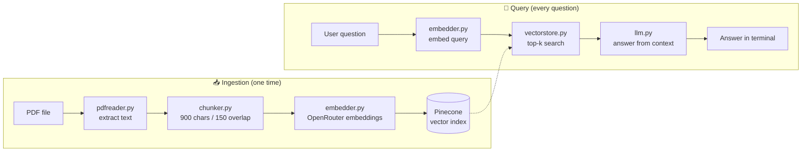

<div align="center">

# 📄 HR Policy RAG Assistant

**Ask questions about a PDF in plain English and get answers grounded in the document, right in your terminal.**


</div>

---

## 📚 Table of Contents

- [Overview](#-overview)
- [Features](#-features)
- [How It Works](#-how-it-works)
- [Project Structure](#-project-structure)
- [Getting Started](#-getting-started)
- [Usage](#-usage)
- [Configuration](#-configuration)
- [Module Reference](#-module-reference)
- [Troubleshooting](#-troubleshooting)
- [Roadmap](#-roadmap)
- [License](#-license)

---

## 🔍 Overview

This project is a small, readable **Retrieval-Augmented Generation (RAG)** pipeline.
It reads a PDF (an HR policy by default), splits it into overlapping chunks, turns each chunk into an embedding, and stores them in **Pinecone**.

When you ask a question, the app embeds your question, retrieves the most relevant chunks from Pinecone, and sends them to an LLM through **OpenRouter**. The LLM answers **only from the retrieved context**. If the document doesn't contain the answer, it says so instead of guessing.

> **Example:** *"If my performance is bad, how many days is the probation period?"*
> The assistant finds the probation section of the HR policy and answers from it.

---

## ✨ Features

- 🗂️ **PDF ingestion:** extracts text from every page with `pypdf`.
- ✂️ **Overlapping chunking:** 900-character chunks with 150 characters of overlap keep context intact across boundaries.
- 🧠 **Free embeddings and LLM:** uses free models on OpenRouter.
- ⚡ **Fast semantic search:** Pinecone returns the top-k most similar chunks.
- 🛡️ **Grounded answers:** the system prompt stops the model from answering beyond the context.
- 💬 **Interactive terminal chat:** run once, then keep asking questions until you type `exit`.
- ♻️ **Smart ingestion:** skips re-ingesting when the index already has data, unless you pass `--ingest`.

---

## ⚙️ How It Works



| Step | What happens | Module |
|------|--------------|--------|
| 1. Read | Extract text from each PDF page | `pdfreader.py` |
| 2. Chunk | Join the pages and split into overlapping windows | `chunker.py` |
| 3. Embed | Convert each chunk into a vector | `embedder.py` |
| 4. Store | Upsert vectors and the chunk text into Pinecone in batches of 100 | `vectorstore.py` |
| 5. Retrieve | Embed the question and fetch the top 4 matching chunks | `embedder.py`, `vectorstore.py` |
| 6. Generate | Send the question and context to the LLM | `llm.py` |

---

## 🗂️ Project Structure

```text
.
├── main.py              # Entry point: optional ingestion + interactive Q&A loop
├── pdfreader.py         # Reads the PDF and returns a list of page texts
├── chunker.py           # Splits text into overlapping chunks
├── embedder.py          # Embeds chunks and queries through OpenRouter
├── vectorstore.py       # Pinecone client: store and search vectors
├── llm.py               # Builds the prompt and calls the LLM through OpenRouter
├── resources/
│   └── HR_Policy_RAG_Demo.pdf   # Source document
├── requirements.txt     # Python dependencies
├── .env.example         # Template for the required environment variables
└── README.md
```

---

## 🚀 Getting Started

### Prerequisites

- Python **3.9+**
- An [OpenRouter](https://openrouter.ai/) API key (free tier works)
- A [Pinecone](https://www.pinecone.io/) account and index

### 1. Clone the repository

```bash
git clone https://github.com/<your-username>/<your-repo>.git
cd <your-repo>
```

### 2. Create a virtual environment

```bash
python -m venv venv

# macOS / Linux
source venv/bin/activate

# Windows
venv\Scripts\activate
```

### 3. Install dependencies

```bash
pip install -r requirements.txt
```

`requirements.txt`:

```text
openai
pinecone
pypdf
python-dotenv
```

### 4. Configure environment variables

Copy `.env.example` to `.env` and fill in your keys:

```env
OPENROUTER_API_KEY=your_openrouter_api_key
PINECONE_API_KEY=your_pinecone_api_key
PINECONE_INDEX_NAME=your_index_name
```

> ⚠️ Never commit your `.env` file. Add it to `.gitignore`.

### 5. Create the Pinecone index

Create an index in the Pinecone console with:

- **Metric:** `cosine`
- **Dimension:** the output size of your embedding model (check the model page on OpenRouter). It must match exactly, or the upserts will fail.

---

## 💬 Usage

Put your PDF at `resources/HR_Policy_RAG_Demo.pdf`, or change `PDF_PATH` in `main.py`. Then run:

```bash
python main.py
```

On the first run the index is empty, so the app ingests the PDF automatically. After that it goes straight to the chat.

To rebuild the index, for example after you change the PDF:

```bash
python main.py --ingest
```

### Example session

```text
$ python main.py
Index already has data, skipping ingestion (use --ingest to rebuild).

Ask me anything about the HR policy. Type 'exit' to quit.

You: If my performance is bad, how many days is the probation period?
Found 4 matches for the query.

Assistant: According to the policy, the probation period can be extended ...

You: How many casual leaves do I get per year?
Found 4 matches for the query.

Assistant: ...

You: exit
Goodbye!
```

Type `exit`, `quit`, `q` or `bye`, or press **Ctrl+C**, to leave.

---

## 🔧 Configuration

| Setting | Location | Default | Description |
|---------|----------|---------|-------------|
| `PDF_PATH` | `main.py` | `./resources/HR_Policy_RAG_Demo.pdf` | Document to ingest |
| `chunk_size` | `main.py` → `chunk_pages()` | `900` | Characters per chunk |
| `chunk_overlap` | `main.py` → `chunk_pages()` | `150` | Characters shared between neighbouring chunks |
| `top_k` | `main.py` → `search_in_pinecone()` | `4` | Number of chunks sent to the LLM |
| `NAMESPACE` | `main.py` | `""` | Pinecone namespace |
| `EMBEDDING_MODEL` | `embedder.py` | `liquid/lfm-2.5-embedding-350m:free` | Embedding model on OpenRouter |
| `LLM_MODEL` | `llm.py` | `openrouter/free` | Chat model; `openrouter/free` picks an available free model |
| `temperature` | `llm.py` | `0.4` | Lower values give more focused answers |

---

## 🧩 Module Reference

<details>
<summary><b>pdfreader.py</b>: <code>read_pdf(pdf_path) -> List[str]</code></summary>

Checks that the file exists and returns one string per page. Pages with no extractable text, such as scanned images, become empty strings.
</details>

<details>
<summary><b>chunker.py</b>: <code>chunk_pages(pages, chunk_size=900, chunk_overlap=150) -> List[str]</code></summary>

Joins all pages into one string and slides a window of `chunk_size` characters, stepping forward by `chunk_size - chunk_overlap`. Empty chunks are skipped.
</details>

<details>
<summary><b>embedder.py</b>: <code>embed_chunks(chunks)</code> / <code>embed_User_query(query)</code></summary>

Calls the OpenRouter embeddings endpoint through the OpenAI SDK and returns the vectors.
</details>

<details>
<summary><b>vectorstore.py</b>: <code>store_in_pinecone(...)</code> / <code>search_in_pinecone(...)</code></summary>

Upserts vectors with IDs `chunk_0`, `chunk_1` and so on, and keeps the original text in the metadata. Search returns the `text` metadata of the top-k matches.
</details>

<details>
<summary><b>llm.py</b>: <code>query_llm_with_context(query, context) -> str</code></summary>

Joins the retrieved chunks into one context block and asks the LLM to answer strictly from it.
</details>

---

## 🛠️ Troubleshooting

| Problem | Likely cause and fix |
|---------|----------------------|
| `FileNotFoundError` | The PDF isn't at `PDF_PATH`. Check the path and the file name. |
| Pinecone dimension mismatch | The index dimension doesn't match the embedding model. Recreate the index with the right dimension. |
| `401` / authentication error | A key in `.env` is missing or wrong. |
| `429` / rate limit | Free models are rate limited. Wait a moment and try again. |
| "Cannot answer based on the given context" | The PDF doesn't cover the question, or a larger `top_k` is needed. |
| Old answers after you change the PDF | Run `python main.py --ingest`. Clear the namespace first if the new PDF is shorter. |

---

## 🗺️ Roadmap

- [ ] Batch embedding requests for faster ingestion
- [ ] Support multiple PDFs with source citations (file and page)
- [ ] Stream LLM responses token by token
- [ ] Keep conversation history for follow-up questions
- [ ] Web UI with Streamlit or Gradio

---

## 📄 License

This project is released under the [MIT License](LICENSE).

<div align="center">
<sub>Built with Python, Pinecone and OpenRouter.</sub>
</div>
